# Challenge 360 — shopCart

Un sistema de comercio electronico ("carrito de compras") construido como challenge de programacion: una API REST en Express + TypeScript, respaldada por SQL Server, con dominios Admin / Operator / Client / Common, autenticacion JWT con un modelo de permisos a nivel de recurso, un worker en segundo plano y notificaciones de correo asincronas via AWS SQS.

Este documento es la fuente unica de verdad sobre como esta construido el proyecto, por que esta construido de esa forma, y como configurarlo y ejecutarlo. Los contratos de request/response por endpoint viven en `backend/spect/*.md`; este README se enfoca en la arquitectura, la infraestructura y el razonamiento detras de ambas.

## Tabla de contenido

- [Estructura del proyecto](#estructura-del-proyecto)
- [Primeros pasos](#primeros-pasos)
- [API](#api)
  - [Estilo arquitectonico: Clean Architecture](#estilo-arquitectonico-clean-architecture)
  - [Capas](#capas)
  - [Ciclo de vida de una peticion](#ciclo-de-vida-de-una-peticion)
  - [Sobre estandar de respuesta](#sobre-estandar-de-respuesta)
  - [Autenticacion y autorizacion](#autenticacion-y-autorizacion)
  - [Cache de catalogos](#cache-de-catalogos)
  - [Worker en segundo plano](#worker-en-segundo-plano-shipmentworker)
  - [Notificaciones de correo asincronas (SQS + DLQ)](#notificaciones-de-correo-asincronas-sqs--dlq)
  - [Almacenamiento de archivos (URLs prefirmadas de S3)](#almacenamiento-de-archivos-urls-prefirmadas-de-s3)
  - [Configuracion y secretos](#configuracion-y-secretos)
  - [Documentacion de la API (Swagger)](#documentacion-de-la-api-swagger)
  - [Manejo de errores y codigos de error/exito](#manejo-de-errores-y-codigos-de-errorexito)
  - [Mapa de endpoints](#mapa-de-endpoints)
- [Base de datos](#base-de-datos)

## Estructura del proyecto

```
challenge_360/
├── backend/           API en Express + TypeScript (documentada abajo)
│   ├── src/
│   ├── spect/         Especificaciones funcionales por feature, escritas antes/junto a la implementacion
│   ├── skills/        Reglas internas de construccion contra las que se implemento la API
│   └── database/      (conceptualmente enlazada a ../database, ver abajo)
├── database/          Esquema de SQL Server, scripts de correccion de drift y stored procedures
└── frontend/          Reservado para la aplicacion cliente (aun no iniciada)
```

El backend es la unica aplicacion implementada por ahora; `frontend/` es un placeholder para una futura interfaz.

## Primeros pasos

```bash
cd backend
pnpm install
cp .env.example .env   # completa los valores descritos en "Configuracion y secretos" abajo
pnpm dev                # ts-node-dev, hot reload
# o
pnpm build && pnpm start
```

La API necesita, como minimo, una instancia de SQL Server alcanzable (ver `database/`) y — para cualquier funcionalidad mas alla de un CRUD basico — un emulador local compatible con AWS ("floci", compatible con LocalStack) escuchando en `AWS_ENDPOINT_URL` para Secrets Manager, S3 y SQS. Todo en la API esta escrito para degradar de forma controlada cuando falta alguna de estas dependencias: el servidor igual arranca, y solo queda deshabilitada la funcionalidad dependiente (rutas respaldadas por DB, subida de archivos, notificaciones por correo) en lugar de hacer caer todo el proceso.

## API

### Estilo arquitectonico: Clean Architecture

La API fue construida deliberadamente con **Clean Architecture** en lugar del estilo "controlador gordo" o MVC clasico en el que suelen caer los proyectos de Express. Las razones:

- **La logica de negocio debe sobrevivir a cambios de infraestructura.** Este proyecto mueve datos a traves de SQL Server hoy, pero las reglas (como se reserva el inventario, como se calcula el descuento de un cupon, cuando expira una pre orden) son la parte valiosa y de larga vida del sistema — no la base de datos especifica, el ORM, ni siquiera que sea Express. Clean Architecture mantiene esa logica en `Core`/`Application`, aislada de `mssql`, `express`, `nodemailer` o el SDK de AWS.
- **Todos los modulos (Admin, Auth, Client, Operator, Common) siguen exactamente la misma forma de cuatro capas.** Esa consistencia es lo que hace que este codebase sea predecible de extender: agregar una funcionalidad nueva significa preguntar "cual es el DTO, cual es la logica de negocio, cual es la consulta, cual es la ruta" — en ese orden — en lugar de inventar un patron nuevo por funcionalidad.
- **Facilidad de pruebas.** Como los Helpers/Services dependen de interfaces y no de clases concretas, la logica de negocio (matematica de cupones, totales de factura, transiciones de estado) se puede probar de forma unitaria sin necesidad de una base de datos ni de un servidor HTTP.
- **Coincide con como se construye realmente el proyecto.** Cada funcionalidad nace como un spec en markdown dentro de `backend/spect/`, se implementa estrictamente siguiendo las reglas de capas en `backend/skills/`, y solo despues obtiene stored procedures y rutas. Clean Architecture es el unico estilo que mapea 1:1 sobre "spec → DTO/Core → regla de negocio/Application → consulta/Infrastructure → ruta/Presentation".

### Capas

```
Presentation  →  Application  →  Core
                      ↓
               Infrastructure  →  Core
```

Las dependencias siempre apuntan hacia adentro/abajo, hacia `Core`. `Core` no depende de nada.

| Capa | Carpeta | Responsabilidad | Puede depender de |
|---|---|---|---|
| **Core** | `src/Core` | Tipos de TypeScript, DTOs, interfaces (contratos) para cada Repository/Service/Helper, los diccionarios de error y exito, las excepciones personalizadas, y las plantillas HTML de correo. TypeScript puro, sin dependencias de frameworks. | nada |
| **Infrastructure** | `src/Infrastructure` | Repositories (las unicas clases autorizadas a tocar la base de datos, y solo a traves de stored procedures/funciones/vistas — nunca consultas directas a tablas), los clientes de AWS para S3/SecretsManager/SQS, el cliente SMTP de correo, y el `Settings` en tiempo de ejecucion (la implementacion de `ISettings` que lee el `.env`). | Core |
| **Application** | `src/Application` | Services (solo orquestacion — llaman a un Repository, llaman a un Helper, arman una respuesta, sin reglas de negocio) y Helpers (**toda la logica de negocio real**: matematica de cupones, totales de factura, planificacion de reserva de inventario, armado del payload de correo). Tambien el middleware de Express (auth, validacion, manejo de errores, CORS) y el `ShipmentWorker` en segundo plano. | Core, Infrastructure |
| **Presentation** | `src/Presentation` | Controladores/Routers de Express y el cableado de Swagger. Los controladores solo parsean la peticion, llaman a un Service, y hacen `res.status(200).json(...)` con el `StandardResponse`. Nunca contienen `try/catch` — toda excepcion sube al manejador de errores global (`express-async-errors` hace que los handlers `async` de las rutas puedan lanzar excepciones de forma segura). | Application, Core |

Cada uno de los cuatro dominios de negocio (Auth, Admin, Client, Operator) mas el modulo compartido Common repite exactamente esta misma forma: interfaces `I<Modulo>Repository` / `I<Modulo>Service` / `I<Modulo>Helper` en Core, una clase concreta por interfaz en la capa correspondiente, y un Controller que solo conoce la interfaz del Service — nunca la clase concreta. El cableado ocurre en un unico lugar, `src/CompositionRoot.ts`, que es el unico archivo del proyecto autorizado a instanciar (`new`) clases concretas de Application/Infrastructure y entregarselas unas a otras como interfaces. `src/index.ts` resuelve todo lo que necesita I/O al arrancar (pool de DB, credenciales de S3/SMTP/SQS desde Secrets Manager) y pasa los resultados a `CompositionRoot`.

**Por que los Services solo orquestan y los Helpers contienen la logica**, en lugar de una unica clase "Service" gorda por modulo: esto mantiene cada metodo de un Service legible como una historia lineal ("obtener los datos, pedirle al helper que haga el calculo, armar la respuesta"), mientras que cada decision real (¿este cupon sigue siendo valido? ¿cuanto impuesto aplica? ¿cual es el siguiente estado de envio?) vive en un unico lugar por concepto, que se puede leer y probar de forma independiente del HTTP o del SQL.

**Por que solo stored procedures, nunca consultas crudas desde la aplicacion:** cada decision a nivel de columna (indices, parseo de JSON via `OPENJSON`, transacciones, bloqueos) queda junto al esquema en `database/StoredProcedures`, y la capa Repository en TypeScript se reduce a "enlazar parametros, llamar a un procedure por nombre, mapear el recordset" — no existe una cadena SQL que se pueda concatenar por accidente, y un DBA puede revisar/optimizar un procedure sin tocar codigo de aplicacion.

### Ciclo de vida de una peticion

```
Peticion HTTP
  → middleware de CORS (buildCorsMiddleware, origenes permitidos desde .env)
  → express.json()
  → [solo rutas protegidas] validateSession (JWT: verifica/rota el par de tokens de acceso+refresco)
  → [solo rutas protegidas] validateRole (valida el/los rol(es) del llamante contra Resource/RoleResource para la ruta exacta)
  → [rutas con body] validationMiddleware (*Validators.ts por modulo — valida forma/campos requeridos, 400 si falla)
  → handler del Controller (parsea params/query/body, llama a un unico metodo de un Service, res.json(StandardResponse))
  → errorHandlerMiddleware (ultimo app.use — captura cualquier CustomException lanzada o Error inesperado)
```

Gracias a `express-async-errors`, un handler de Controller simplemente puede hacer `throw new CustomException(...)` (o dejar que un error del repository se propague) desde dentro de una funcion `async` — no existe ningun `next(error)` repetido en ningun Controller.

### Sobre estandar de respuesta

Cada endpoint — exitoso o fallido — retorna exactamente la misma forma, construida por `CommonHelper.buildResponse`:

```ts
interface StandardResponse<T> {
  success: boolean;
  message: string;            // legible por humanos, en espaniol, desde SuccessDictionary/ErrorDictionary
  statusCode: number;
  data: T | null;
  errorCode: string | null;   // p.ej. "CLI0002"
  errorMessage: string | Record<string, string> | null;
  traceID: string;            // UUID aleatorio, generado por respuesta, util para correlacionar logs
}
```

Un unico sobre predecible significa que el frontend nunca tiene que ramificar su logica de parseo por endpoint, y cada error es rastreable por `traceID` sin importar en que capa fue lanzado.

### Autenticacion y autorizacion

- **La autenticacion** se basa en JWT (`AuthHelper` firma/verifica, usando `jsonwebtoken`). El token de acceso tiene vida corta (`JWT_ACCESS_EXPIRES_IN_SECONDS`, por defecto 900s); el token de refresco tiene vida larga (`JWT_REFRESH_EXPIRES_IN_SECONDS`, por defecto 14 dias) y se persiste en la tabla `Session`. `buildValidateSessionMiddleware` verifica el token de acceso y, si expiro pero el token de refresco sigue siendo valido y activo, rota de forma transparente ambos tokens y adjunta el nuevo par al body de la respuesta bajo `data.refreshSession` — los clientes nunca necesitan llamar a un endpoint separado de "refresh".
- **La autorizacion no es un `if (role !== 'admin')` hardcodeado en ningun lugar del codigo.** Es dirigida por datos: `Resource` tiene una fila por cada ruta protegida (`ResourcePath`, guardado exactamente como el patron de ruta de Express, p.ej. `/api/client/pre-order/:idInvoice/item`), y `RoleResource` mapea roles a los recursos que tienen permitido llamar. `buildValidateRoleMiddleware` reconstruye el path del recurso a partir de `req.baseUrl + req.route.path` y le pregunta a `SP_Auth_ValidarPermisoRol` si el/los rol(es) del llamante estan vinculados a ese recurso. Agregar un endpoint protegido nuevo es entonces un proceso de dos pasos: escribir la ruta, e insertar una fila `Resource`/`RoleResource` en el schema del modulo correspondiente (ver el patron en `database/3.Admin_Schema.sql` y `database/4.Operator_Client_Schema.sql`) — nunca un cambio de codigo en la validacion de permisos en si.
- Las contrasenias se hashean con Argon2 (via `AuthHelper`), el salt lo maneja internamente la libreria.

### Cache de catalogos

Las tablas de consulta que se leen mucho y cambian poco (`CatProductType`, `CatCuponType`, `Role`, `CatShippmentStatus`, `CatShippmentMethod`, `CatReverseReason`) se cargan una sola vez en un snapshot en memoria (`CommonModuleHelper`) justo despues de que el pool de DB esta listo, y nuevamente cada vez que un Admin modifica alguna de ellas (`createProductType`, `updateCupon`, etc. llaman a `commonService.warmCatalogCache()`). `GET /api/common/catalog` lee unicamente desde ese snapshot — sin ida y vuelta a la base de datos por peticion.

Esto es intencionalmente un objeto plano en memoria, no Redis ni otro cache externo: el conjunto de datos es pequenio, se lee muchisimo mas de lo que cambia, un arranque en frio solo implica una consulta extra, y mantiene la huella de infraestructura del proyecto en "un SQL Server + un emulador compatible con AWS" en lugar de agregar una tercera dependencia con estado solo por un puniado de filas. El mismo razonamiento se extendio de forma natural al cache de notificaciones de envio descrito abajo, que reutiliza exactamente el mismo patron en memoria.

### Worker en segundo plano (`ShipmentWorker`)

`src/Application/Workers/ShipmentWorker.ts` se inicia una sola vez, desde `index.ts`, justo despues de que el pool de DB y el cache de catalogos estan listos, y es responsable de dos tareas independientes:

1. **Expiracion de pre ordenes.** Un carrito de compras ("pre orden") reserva inventario en el momento en que se agregan productos, de forma que un segundo cliente nunca pueda comprar las mismas unidades que estan en el carrito de otra persona. Si ese carrito se abandona, esas unidades deben regresar. Cada `PREORDER_WORKER_INTERVAL_MS` (por defecto **1000 ms**) el worker llama a `SP_Client_LiberarPreOrdenesExpiradas`, que busca toda factura que siga en estado `En pre orden` cuyo `LastItemAddedAt` sea mas antiguo que `PREORDER_EXPIRATION_MINUTES` (por defecto **15**) y, en una sola transaccion, restaura la cantidad reservada, registra la restauracion en `InventoryMove`, marca la factura y sus items como inactivos, y pasa la factura a estado `No transicionada`.
2. **Entrega de notificaciones de envio.** Hace long-polling sobre la cola SQS descrita abajo y, por cada mensaje, renderiza y envia el correo correspondiente.

**Por que un unico worker y no dos servicios separados:** ambas tareas son "tareas pequeñas y frecuentes en segundo plano para el mismo contexto acotado (envios)" y ambas necesitan las mismas dependencias (`ClientService`/`CommonModuleHelper`/`ISettings`). Correr las dos como un `setInterval` mas un loop de long-polling dentro del mismo proceso de la API que ya esta corriendo evita levantar y operar un segundo desplegable para lo que, a la escala de este proyecto, son unas pocas lineas de trabajo recurrente. Si en algun momento esto necesitara escalar de forma independiente o tener un ciclo de despliegue propio, `ShipmentWorker` ya esta lo suficientemente aislado (solo depende de interfaces) como para moverse a su propio proceso sin tocar ninguna otra capa.

El worker degrada de forma controlada: el loop de liberacion de pre ordenes solo necesita el pool de DB, asi que siempre corre una vez que la API tiene uno; el lado de SQS/correo simplemente se omite (con un log de advertencia) si la cola de notificaciones o las credenciales SMTP no estan configuradas en ese entorno.

### Notificaciones de correo asincronas (SQS + DLQ)

Cuando un Operador avanza el estado de un envio (`PATCH /api/operator/shippment-status`), la peticion **no** envia un correo de forma sincrona. En cambio:

1. `OperatorService` arma un payload de notificacion pequenio (destinatario, nombre, numero de factura, guia, nuevo estado) y lo publica como un mensaje JSON en una cola SQS (`SQS_QUEUE_NAME`).
2. `ShipmentWorker` es el unico consumidor: hace long-polling sobre la cola (`SQS_WAIT_TIME_SECONDS`), y por cada mensaje renderiza un correo HTML desde `Core/Templates/EmailTemplates.ts` y lo envia via SMTP de Gmail.
3. Solo despues de un envio exitoso se elimina el mensaje de la cola y se registra la notificacion en el cache en memoria (expuesto como `recentShipmentNotifications` en `GET /api/common/dashboard`).
4. Si el envio sigue fallando, SQS redirige el mensaje automaticamente; una vez que fue recibido `SQS_MAX_RECEIVE_COUNT` veces (por defecto 5) sin ser eliminado, SQS mismo lo mueve a la **cola de mensajes muertos (DLQ)** (`SQS_DLQ_NAME`) — no hizo falta escribir codigo de reintentos/backoff, queda resuelto enteramente por el `RedrivePolicy` de la cola.

**Por que una cola en lugar de enviar el correo directamente dentro de la peticion:** una llamada SMTP es lenta y ocasionalmente inestable (exactamente el tipo de dependencia externa que nunca deberia bloquear o hacer fallar la peticion de actualizacion de estado de un operador), y "enviar un correo" es naturalmente una operacion de disparar-y-olvidar, reintentable y de entrega al menos una vez — que es precisamente lo que SQS da gratis. Tambien significa que las plantillas de correo y el transporte SMTP real viven en un unico camino bien aislado (el worker), en lugar de duplicarse en cualquier otro lugar donde a futuro se necesite disparar una notificacion.

Tanto la cola como su DLQ se crean automaticamente al arrancar si todavia no existen (`SqsQueueService.ensureInfrastructure`, llamado desde `index.ts`), enlazando el ARN de la DLQ en el `RedrivePolicy` de la cola principal — de modo que un entorno local ("floci") recien creado se auto-aprovisiona sus propias colas la primera vez que arranca la API.

**Las plantillas HTML viven en `Core`, no en Infrastructure:** `buildShipmentStatusEmailHtml`/`buildShipmentStatusEmailSubject` son funciones puras, sin dependencias (constructores de strings HTML con estilos inline, con marca, con color segun el estado) — exactamente el tipo de logica libre de framework para la que existe `Core`. `Infrastructure/Email/SmtpEmailService` solo sabe como enviar un string HTML via SMTP; no tiene idea de que es un "estado de envio".

### Almacenamiento de archivos (URLs prefirmadas de S3)

Las subidas de Admin nunca pasan por el servidor de la API: `POST /api/admin/stored-file` retorna URLs PUT de S3 prefirmadas de corta duracion (`PRESIGNED_URL_EXPIRATION_SECONDS`, por defecto 900s), y el cliente sube los bytes del archivo directamente a S3. Esto mantiene la API sin estado y evita hacer de proxy de payloads binarios a traves de Node. `GET /api/common/file` lee un archivo almacenado de vuelta desde S3 por su bucket key para mostrarlo.

### Configuracion y secretos

Toda la configuracion en tiempo de ejecucion se lee una sola vez, al arrancar, en una unica implementacion de `ISettings` (`Infrastructure/Settings/Settings.ts`) y se inyecta en todo lo demas — ningun otro codigo fuera de ese archivo lee `process.env` directamente. La configuracion esta deliberadamente dividida en dos lugares, siguiendo una regla aplicada de forma consistente en todo el proyecto:

> **La configuracion no sensible (nombres, tamanios, timeouts, interruptores de funcionalidad) vive en `.env`. Las credenciales reales viven en AWS Secrets Manager**, resueltas una sola vez al arrancar usando una llave de AWS de arranque que en si misma solo tiene los privilegios necesarios para leer esos secretos especificos.

Por esto, por ejemplo, `SQS_QUEUE_NAME`/`SQS_DLQ_NAME` son valores planos de `.env` pero las credenciales IAM usadas para hablar con SQS se obtienen del secreto nombrado por `SECRET_SQS_CREDENTIALS_NAME`; la misma division aplica para la cadena de conexion de la base de datos, S3 y SMTP. El beneficio: rotar una credencial es una operacion de Secrets Manager sin necesidad de un deploy, `.env`/`.env.example` nunca corren el riesgo de filtrar un secreto real al control de versiones, y cada dependencia externa (DB, S3, SMTP, SQS) se resuelve a traves del mismo patron `secretsManager.getSecretString`/`getSecretJson` en `index.ts`, cada una con su propio manejo de fallo (`console.warn` + la funcionalidad se degrada, en lugar de tumbar todo el proceso) si ese secreto no esta presente en un entorno dado.

| Variable | Proposito | Valor por defecto |
|---|---|---|
| `PORT` | Puerto HTTP | `3000` |
| `NODE_ENV` | `development` \| `production` | `development` |
| `ALLOWED_ORIGINS` | Lista de origenes permitidos para CORS, separados por coma | _(vacio)_ |
| `JWT_SECRET` | Secreto de firma HMAC para los tokens de acceso/refresco | _(requerido)_ |
| `JWT_ACCESS_EXPIRES_IN_SECONDS` | Vida util del token de acceso | `900` |
| `JWT_REFRESH_EXPIRES_IN_SECONDS` | Vida util del token de refresco | `1209600` |
| `AWS_REGION` / `AWS_ENDPOINT_URL` | Region y endpoint del emulador ("floci"/LocalStack) para todos los clientes del SDK de AWS | `us-east-1` / _(vacio = AWS real)_ |
| `AWS_ACCESS_KEY_ID` / `AWS_SECRET_ACCESS_KEY` | Credenciales de arranque — solo se usan para alcanzar Secrets Manager (y, para las operaciones propias del bucket, S3) | _(requerido)_ |
| `S3_BUCKET_NAME` | Bucket para fotos de producto y logos de metodos de envio | _(requerido)_ |
| `PRESIGNED_URL_EXPIRATION_SECONDS` | TTL de la URL de subida prefirmada | `900` |
| `SECRET_DB_CONNECTION_STRING_NAME` | Nombre del secreto en Secrets Manager → cadena de conexion a SQL Server | _(vacio = sin DB)_ |
| `SECRET_S3_CREDENTIALS_NAME` | Nombre del secreto en Secrets Manager → JSON `{accessKeyId, secretAccessKey, bucket, region}` | _(vacio = sin almacenamiento de archivos)_ |
| `SECRET_SMTP_CREDENTIALS_NAME` | Nombre del secreto en Secrets Manager → JSON `{host, port, user, pass, fromAddress, fromName}` (SMTP de Gmail) | _(vacio = sin correos)_ |
| `SECRET_SQS_CREDENTIALS_NAME` | Nombre del secreto en Secrets Manager → JSON `{accessKeyId, secretAccessKey, region}`, acotado solo a las dos colas de abajo | _(vacio = sin notificaciones)_ |
| `SQS_QUEUE_NAME` / `SQS_DLQ_NAME` | Cola de notificaciones de envio y su cola de mensajes muertos (se crean automaticamente al arrancar) | `shopcart-shipment-notifications(-dlq)` |
| `SQS_MAX_RECEIVE_COUNT` | Entregas permitidas antes de que un mensaje sea redirigido a la DLQ | `5` |
| `SQS_WAIT_TIME_SECONDS` | Tiempo de espera de long-polling por llamada a `ReceiveMessage` | `10` |
| `PREORDER_EXPIRATION_MINUTES` | Tiempo de inactividad antes de liberar una pre orden (carrito) | `15` |
| `PREORDER_WORKER_INTERVAL_MS` | Cada cuanto el worker busca pre ordenes expiradas | `1000` |
| `TAX_IVA_PERCENTAGE` | Porcentaje de IVA aplicado al subtotal de cada factura | `12` |

Los alias de rutas (`@Core`, `@Application`, `@Infrastructure`, `@Presentation`, cada uno resuelto contra `src/<Capa>/index.ts`) estan configurados en `tsconfig.json` y se reescriben en tiempo de build por `tsc-alias`, de forma que la regla de dependencias ("Infrastructure/Application solo pueden importar `@Core`, `@Infrastructure`, nunca entrar a los internos de otra capa") queda reforzada por como estan escritos los imports, no solo por convencion.

### Documentacion de la API (Swagger)

Cada ruta esta anotada con un bloque JSDoc `@openapi` justo encima de su registro en el Controller; `swagger-jsdoc` escanea `src/Presentation/Controllers/*.ts` al arrancar y sirve el spec generado, de forma interactiva, en `GET /swagger`.

### Manejo de errores y codigos de error/exito

`CustomException(statusCode, errorCode, errorMessage)` es la unica forma en que el codigo de aplicacion señala un error de negocio; se lanza desde un Service (luego de que un Repository rechaza con un mensaje `THROW` de SQL conocido, como `INSUFFICIENT_STOCK` o `CUPON_EXPIRED`) y se captura una unica vez, en `errorHandlerMiddleware`, que lo transforma al sobre estandar. Todos los codigos estan centralizados en `Core/Dictionaries/{ErrorDictionary,SuccessDictionary}.ts`, agrupados por prefijo de modulo (`AUTH*`, `ADM*`, `OP*`, `CLI*`, `VAL*`, `SYS0000` para cualquier cosa inesperada) — el prefijo por si solo indica que modulo lanzo el error.

### Mapa de endpoints

| Modulo | Metodo y ruta | Rol | Proposito |
|---|---|---|---|
| Auth | `POST /api/auth/account` | publico | Crear una cuenta de cliente |
| Auth | `POST /api/auth/account/privado` | Admin | Crear una cuenta con un rol explicito |
| Auth | `POST /api/auth/login` | publico | Iniciar sesion, retorna tokens de acceso y refresco |
| Admin | `POST`/`GET`/`PUT`/`DELETE /api/admin/product(/:idProduct)` | Admin | CRUD de productos + variantes + fotos |
| Admin | `POST /api/admin/stored-file` | Admin | URLs prefirmadas de subida a S3 |
| Admin | `PUT /api/admin/user/:idUser/inactivate` | Admin | Inactivar un usuario |
| Admin | `POST`/`GET`/`PUT`/`DELETE /api/admin/cupon(/:idCupon)` | Admin | CRUD de cupones |
| Admin | `POST`/`GET`/`PUT`/`DELETE /api/admin/product-type(/:idProductType)` | Admin | CRUD de tipos de producto |
| Common | `GET /api/common/product` | publico | Catalogo de productos paginado |
| Common | `GET /api/common/catalog` | cualquier rol autenticado | Tablas de catalogo en cache para el rol del llamante |
| Common | `GET /api/common/file` | publico | Lee un archivo almacenado desde S3 |
| Common | `GET /api/common/dashboard` | Admin, Operator | Metricas de envios + notificaciones recientes |
| Operator | `PATCH /api/operator/inventory` | Operator | Suma/resta inventario en lote por SKU |
| Operator | `PATCH /api/operator/shippment-status` | Operator | Avanza el estado de un envio, encola la notificacion |
| Operator | `GET /api/operator/shippment` | Operator | Listado paginado de envios confirmados |
| Client | `POST /api/client/pre-order` | Client | Crea un carrito, reservando inventario |
| Client | `POST /api/client/pre-order/:idInvoice/item` | Client | Agrega un producto a un carrito abierto |
| Client | `PATCH /api/client/shippment/:idInvoice` | Client | Confirma el checkout, aplica cupon, calcula totales |
| Client | `GET /api/client/invoice(/:idInvoice)` | Client | Listado/detalle de las facturas propias del cliente |

Los contratos completos de request/response, reglas de validacion y comportamiento de negocio por endpoint estan documentados en `backend/spect/spect_00001_AUHT_flows.md`, `spect_00002_Admin_flows.md` y `spect_00003_operator_client_flows.md`.

## Base de datos

```mermaid
erDiagram
    userSystem {
        int IDUser PK
        varchar(200) UserFirstName
        varchar(200) UserLastName
        varchar(300) UserPassword
        varchar(150) UserEmail
        Datetime UserBirthday
        bit isUserActive
    }

    SystemEntity {
        int IDSystem PK
        varchar(100) SystemName
        varchar(400) SystemDescription
        varchar(50) SystemPublicCode
    }

    Session {
        int IDSession PK
        int IDUser FK
        varchar(150) SessionRefreshToken
        Datetime SessionRefreshTokenExpire
        bit SessionIsActive
    }

    Role {
        int IDRole PK
        int IDSystem FK
        varchar(100) RoleName
        varchar(400) RoleDescription
        varchar(50) RolePublicCode
    }

    UserRole {
        int IDUser PK,FK
        int IDRole PK,FK
    }

    CatResourceType {
        int IDResourceType PK
        varchar(100) ResourceTypeName
        varchar(400) ResourceTypeDescription
    }

    Resource {
        int IDResource PK
        varchar(100) ResourceName
        varchar(400) ResourceDescription
        int IDResourceType FK
        varchar(200) ResourcePath
        varchar(100) ResourceIcon
        varchar(150) ResourceComponent
        int IDResourceParent FK
    }

    RoleResource {
        int IDRole PK,FK
        int IDResource PK,FK
    }

    CatProductType {
        int IDProductType PK
        varchar(100) ProductTypeName
        varchar(400) ProductTypeDescription
        bit rowStatus
    }

    Product {
        int IDProduct PK
        int IDProductType FK
        varchar(100) ProductName
        varchar(600) ProductDescription
        int ProductUserCreatedBy FK
        Datetime ProductUserCreatedAt
        int ProductUserUpdatedBy FK
        Datetime ProductUserUpdatedAt
        varchar(50) ProductPublicCode
        bit rowStatus
    }

    ProductVariant {
        int IDVariant PK
        int IDProduct FK
        varchar(100) SKU
        varchar(50) Size
        varchar(100) Color
        varchar(400) Features
        decimal(18_2) Price
        int Quantity
        bit isDefault
        bit rowStatus
        int VariantUserCreatedBy FK
        Datetime VariantUserCreatedAt
        int VariantUserUpdatedBy FK
        Datetime VariantUserUpdatedAt
    }

    StoredFile {
        int IDFile PK
        int IDProductVariant FK
        varchar(50) FileName
        varchar(200) FileBucketKey
        varchar(100) FileContentType
        int FileUserCreatedBy FK
        Datetime FileUserCreatedAt
        int FileUserUpdatedBy FK
        Datetime FileUserUpdatedAt
    }

    InventoryMove {
        int IDMove PK
        int IDUserMove FK
        int IDProductVariant FK
        int Quantity
        varchar(20) moveType
        Datetime MoveCreatedAt
    }

    CatShippmentStatus {
        int IDShippmentStatus PK
        varchar(100) ShippmentStatusName
        varchar(400) ShipmentStatusDescription
    }

    CatShippmentMethod {
        int IDShipmmentMethod PK
        varchar(100) ShippmentMethodCompanyName
        varchar(400) ShippmentMethodDescription
        decimal(18_2) ShipmentPrice
        varchar(200) ShipmentLogoCompanyBucketKey
    }

    CatCuponType {
        int IDCuponType PK
        varchar(100) CuponTypeName
        varchar(400) CuponTypeDescription
    }

    Cupon {
        int IDCupon PK
        int IDCuponType FK
        varchar(100) CuponCode
        int limitUseTotal
        int limitUsePerClient
        decimal(18_2) CuponValue
        Datetime CuponExpiration
        bit isPerCategory
        bit rowStatus
        int CuponUserCreatedBy FK
        Datetime CuponUserCreatedAt
        int CuponUserUpdatedBy FK
        Datetime CuponUserUpdatedAt
    }

    CuponPerCategory {
        int IDCupon PK,FK
        int IDProductType PK,FK
    }

    CatReverseReason {
        int IDReverseReason PK
        varchar(100) ReverseReasonName
        varchar(400) ReverseReasonDescription
    }

    Invoice {
        int IDInvoice PK
        int IDUser FK
        varchar(900) InvoiceNumber
        varchar(300) AddressLine1
        varchar(300) AddressLine2
        Datetime InvoiceDate
        varchar(50) DocumentNumber
        varchar(70) ShippmentGuide
        int IDShipmentStatus FK
        int IDShippmmentMethod FK
        int IDCuponApplied FK
        bit isPayVDelivered
        bit isReversed
        varchar(200) ReversedNotes
        int InvoiceUserUpdatedBy FK
        Datetime InvoiceUserUpdatedAt
        bit rowStatus
        Datetime LastItemAddedAt
    }

    InvoiceItem {
        int IDInvoiceItem PK
        int IDInvoice FK
        int IDProductVariant FK
        int Quantity
        decimal(18_2) PriceShiped
        bit isReversed
        int IDReverseReason FK
        bit rowStatus
    }

    %% Seguridad
    userSystem ||--o{ Session : "Posee"
    SystemEntity ||--o{ Role : "Define"
    userSystem ||--o{ UserRole : "Tiene"
    Role ||--o{ UserRole : "Asignado_a"
    CatResourceType ||--o{ Resource : "Clasifica"
    Resource |o--o{ Resource : "Padre_de"
    Role ||--o{ RoleResource : "Tiene"
    Resource ||--o{ RoleResource : "Permitido_en"

    %% Catalogo e inventario
    CatProductType ||--o{ Product : "Categoriza"
    Product ||--o{ ProductVariant : "Contiene"
    ProductVariant ||--o{ StoredFile : "Adjunta"
    ProductVariant ||--o{ InventoryMove : "Registra_movimiento"
    userSystem ||--o{ InventoryMove : "Audita_movimiento"

    %% Cupones
    CatCuponType ||--o{ Cupon : "Define_tipo"
    Cupon ||--o{ CuponPerCategory : "Restringe"
    CatProductType ||--o{ CuponPerCategory : "Aplica"

    %% Ventas y facturacion
    userSystem ||--o{ Invoice : "Compra"
    CatShippmentStatus ||--o{ Invoice : "Estado"
    CatShippmentMethod ||--o{ Invoice : "Transporta"
    Cupon |o--o{ Invoice : "Descuenta"
    Invoice ||--o{ InvoiceItem : "Detalla"
    ProductVariant ||--o{ InvoiceItem : "Vendido_como"
    CatReverseReason |o--o{ InvoiceItem : "Motivo_Reversa"

    %% Auditoria
    userSystem ||--o{ Product : "Audita_Creacion_Edicion"
    userSystem ||--o{ ProductVariant : "Audita_Creacion_Edicion"
    userSystem ||--o{ StoredFile : "Audita_Creacion_Edicion"
    userSystem ||--o{ Cupon : "Audita_Creacion_Edicion"
    userSystem ||--o{ Invoice : "Audita_Edicion"
```


