## name: build-endpoint-express-ts
description: Builds an endpoint or function for an Express.js + TypeScript project (Worker, API, npm package) using SOLID, KISS, and DRY principles, strictly adhering to Clean Architecture constraints.

# BUILD ENDPOINT OR FUNCTION EXPRESS.JS + TYPESCRIPT

This skill guides the user through building a specific endpoint, function, or flow inside an existing Express.js + TypeScript clean architecture solution.

## Database Entity Relationship Diagram
*Agent Note: Refer to this diagram for database context. If this section is empty, ask the user to provide the Mermaid ER diagram to populate it for future features.*

```mermaid
erDiagram
    userSystem {
        int IDUser PK
        varchar(200) UserFirstName
        varchar(200) UserLastName
        varchar(300) UserPassword
        varchar(150) UserEmail
        Datetime UserBirthday
    }

    SystemEntity {
        int IDSystem PK
        varchar(100) SystemName
        varchar(400) SystemDescription
        varchar(50) SystemPublicCode
    }

    Session {
        int IDSession PK
        int IDUser FK
        varchar(150) SessionRefreshToken
        Datetime SessionRefreshTokenExpire
        bit SessionIsActive
    }

    Role {
        int IDRole PK
        int IDSystem FK
        varchar(100) RoleName
        varchar(400) RoleDescription
        varchar(50) RolePublicCode
    }

    CatResourceType {
        int IDResourceType PK
        varchar(100) ResourceTypeName
        varchar(400) ResourceTypeDescription
    }

    Resource {
        int IDResource PK
        varchar(100) ResourceName
        varchar(400) ResourceDescription
        int IDResourceType FK
        varchar(200) ResourcePath
        varchar(100) ResourceIcon
        varchar(150) ResourceComponent
        int IDResourceParent FK
    }

    RoleResource {
        int IDRole PK,FK
        int IDResource PK,FK
    }

    CatProductType {
        int IDProductType PK
        varchar(100) ProductTypeName
        varchar(400) ProductTypeDescription
    }

    Product {
        int IDProduct PK
        int IDProductType FK
        varchar(100) ProductName
        varchar(600) ProductDescription
        int ProductUserCreatedBy FK
        Datetime ProductUserCreatedAt
        int ProductUserUpdatedBy FK
        Datetime ProductUserUpdatedAt
        varchar(50) ProductPublicCode
        bit rowStatus
    }

    ProductVariant {
        int IDVariant PK
        int IDProduct FK
        varchar(100) SKU
        varchar(50) Size
        varchar(100) Color
        varchar(400) Features
        decimal(18_2) Price
        int Quantity
        bit isDefault
        bit rowStatus
        int VariantUserCreatedBy FK
        Datetime VariantUserCreatedAt
        int VariantUserUpdatedBy FK
        Datetime VariantUserUpdatedAt
    }

    StoredFile {
        int IDFile PK
        int IDProductVariant FK
        varchar(50) FileName
        varchar(200) FileBucketKey
        varchar(100) FileContentType
        int FileUserCreatedBy FK
        Datetime FileUserCreatedAt
        int FileUserUpdatedBy FK
        Datetime FileUserUpdatedAt
    }

    CatShippmentStatus {
        int IDShippmentStatus PK
        varchar(100) ShippmentStatusName
        varchar(400) ShipmentStatusDescription
    }

    CatShippmentMethod {
        int IDShipmmentMethod PK
        varchar(100) ShippmentMethodCompanyName
        varchar(400) ShippmentMethodDescription
        decimal(18_2) ShipmentPrice
        varchar(200) ShipmentLogoCompanyBucketKey
    }

    CatCuponType {
        int IDCuponType PK
        varchar(100) CuponTypeName
        varchar(400) CuponTypeDescription
    }

    Cupon {
        int IDCupon PK
        int IDCuponType FK
        varchar(100) CuponCode
        int limitUseTotal
        int limitUsePerClient
        decimal(18_2) CuponValue
        Datetime CuponExpiration
        bit isPerCategory
        int CuponUserCreatedBy FK
        Datetime CuponUserCreatedAt
        int CuponUserUpdatedBy FK
        Datetime CuponUserUpdatedAt
    }

    CuponPerCategory {
        int IDCupon PK,FK
        int IDProductType PK,FK
    }

    CatReverseReason {
        int IDReverseReason PK
        varchar(100) ReverseReasonName
        varchar(400) ReverseReasonDescription
    }

    Invoice {
        int IDInvoice PK
        int IDUser FK
        varchar(300) AddressLine1
        varchar(300) AddressLine2
        Datetime InvoiceDate
        varchar(50) DocumentNumber
        varchar(70) ShippmentGuide
        int IDShipmentStatus FK
        int IDShippmmentMethod FK
        int IDCuponApplied FK
        bit isPayVDelivered
        bit isReversed
        varchar(200) ReversedNotes
        int InvoiceUserUpdatedBy FK
        Datetime InvoiceUserUpdatedAt
    }

    InvoiceItem {
        int IDInvoiceItem PK
        int IDInvoice FK
        int IDProductVariant FK
        int Quantity
        decimal(18_2) PriceShiped
        bit isReversed
        int IDReverseReason FK
    }

    %% Relaciones del Sistema y Seguridad
    userSystem ||--o{ Session : "Posee"
    SystemEntity ||--o{ Role : "Define"
    CatResourceType ||--o{ Resource : "Clasifica"
    Resource |o--o{ Resource : "Padre_de"
    Role ||--o{ RoleResource : "Tiene"
    Resource ||--o{ RoleResource : "Permitido_en"

    %% Relaciones de Catálogo e Inventario
    CatProductType ||--o{ Product : "Categoriza"
    Product ||--o{ ProductVariant : "Contiene"
    ProductVariant ||--o{ StoredFile : "Adjunta"

    %% Relaciones de Cupones
    CatCuponType ||--o{ Cupon : "Define_tipo"
    Cupon ||--o{ CuponPerCategory : "Restringe"
    CatProductType ||--o{ CuponPerCategory : "Aplica"

    %% Relaciones de Ventas y Facturación
    userSystem ||--o{ Invoice : "Compra"
    CatShippmentStatus ||--o{ Invoice : "Estado"
    CatShippmentMethod ||--o{ Invoice : "Transporta"
    Cupon |o--o{ Invoice : "Descuenta"
    Invoice ||--o{ InvoiceItem : "Detalla"
    ProductVariant ||--o{ InvoiceItem : "Vendido_como"
    CatReverseReason |o--o{ InvoiceItem : "Motivo_Reversa"

    %% Relaciones de Auditoría (User Created/Updated)
    userSystem ||--o{ Product : "Audita_Creacion_Edicion"
    userSystem ||--o{ ProductVariant : "Audita_Creacion_Edicion"
    userSystem ||--o{ StoredFile : "Audita_Creacion_Edicion"
    userSystem ||--o{ Cupon : "Audita_Creacion_Edicion"
    userSystem ||--o{ Invoice : "Audita_Edicion"
```

## Phase 1: Information Gathering
You must ask the following questions step-by-step. If any information is missing or unclear, **STOP** and ask the user. Do not use your own criteria or make assumptions.

1. **What type of project is it?** (WORKER, NPM PACKAGE, or API)
2. **What type of flow is it?** (CRUD or Custom)
   * *Strict Rule:* If Custom, the user MUST provide a Mermaid diagram representing the flow. If they do not, **STOP** and refuse to proceed until it is provided. 
3. **What is the DB script?** Provide the example script for the Stored Procedure, Function, or View.
   * *Strict Rule:* The user must upload the script for development. You (the agent) can ONLY use stored procedures, functions, or views to consume the SQL Server Database. Direct table queries (e.g., SELECT * FROM) are strictly forbidden.
4. **What is the DTO (TypeScript Interface/Type) or query params request?**
5. **What is the standard DTO (TypeScript Interface/Type) response?**
6. **What is the endpoint path?** (If the project is a Worker or npm package, this should be the Class/Module name instead).
7. **What is the endpoint method or verb?** (Only ask this if the project is an API; ignore for Worker or npm package).

## Phase 2: Action & Execution Logic

* **For CRUD Flows:** Wait for the user to provide the exact stored procedure, function, or view script based on the affected tables, and build the simple action.
* **For Custom Flows:** Build the code strictly following the user-provided Mermaid diagram.
* **Diagram Codes:** The flow diagrams should contain error codes + messages and success codes + messages. If they do not exist in the diagram, you must invent them in **Spanish** and add them to the system dictionaries.
* **Conflict Resolution:** Check if the endpoint/controller and method already exist.
  * If it exists, ask the user: *"Is this an extension or a replacement of the previous endpoint?"*
  * If extension: Develop ONLY what is new.
  * If replacement: Replace the entire endpoint/controller.

## Phase 3: Strict Architecture & Layer Restrictions

You must strictly use the existing architecture. Do not introduce new architectural patterns.

### Development Principles
All generated code must strictly use **SOLID**, **KISS** (Keep It Simple, Stupid), and **DRY** (Don't Repeat Yourself) principles. Leverage TypeScript features appropriately. If logic can be reused, put it in a `CommonHelper`.

### Layer Rules (Strict)
* **Presentation Layer (Routers & Controllers):** Consumes Application and Core only. Express Controllers strictly return Status Code 200 with the standard response via `res.status(200).json(...)`. Error handling is non-existent here; all exceptions must be passed to the global error handler middleware (e.g., using `next(error)` or throwing inside an async wrapper).
* **Application Layer:** 
  * Consumes Core and Infrastructure. 
  * **Service Classes/Modules:** Can **ONLY** orchestrate the flow. They cannot contain business logic.
  * **Helper Classes/Modules:** Must contain all the actual business logic.
* **Core Layer:** Contains TypeScript Types, Interfaces, DTOs, Enums, and Dictionaries. Consumes NO other layers.
* **Infrastructure Layer:** Contains Repositories and Data Transformation. Consumes ONLY the Core layer.
  * **MANDATORY:** Only Repositories are allowed to access the database. Repositories are STRICTLY limited to executing stored procedures, functions, or views to consume the SQL Server Database. Direct table queries are not allowed. Build TypeScript interfaces to pass data between the Repo and the Helper/Service.

## Agent Final Warning
If at any point a requirement is unclear, or the user's request violates these constraints, **STOP**. Inform the user exactly what is needed to proceed. You are a strict compiler of these rules.
