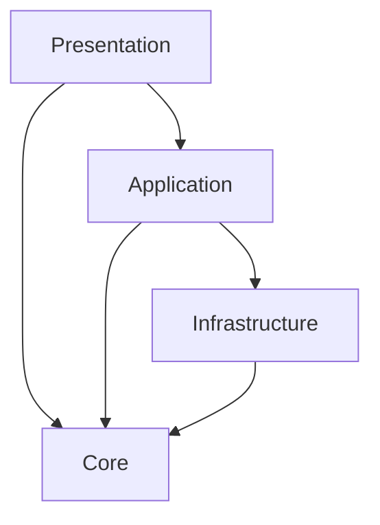
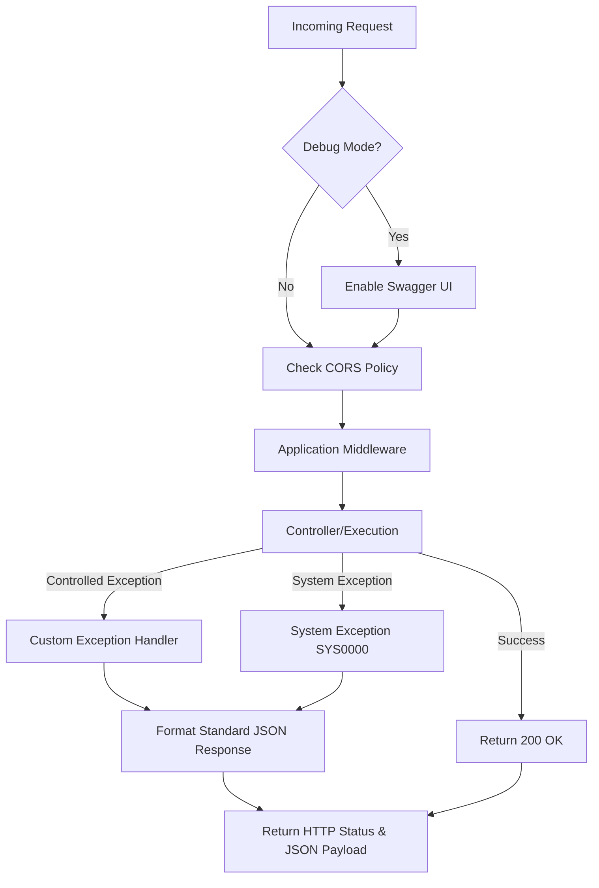

---
name: build-solution-express-ts
description: Builds a blank Express JS with TypeScript solution (API, Worker, Package) with clean architecture layers inside a src directory, zero try-catch middleware (using express-async-errors), SQL Server DB initializer with an injectable connection pool, and strict adherence to SOLID, KISS, and DRY.
---

# BUILD SOLUTION EXPRESS TS

Guides the user through building a strict Express JS with TypeScript clean architecture solution.

## Development Principles
All code generated must strictly adhere to:
* **SOLID Principles:** Single responsibility, open-closed, Liskov substitution, interface segregation, and dependency inversion.
* **KISS (Keep It Simple, Stupid):** Avoid unnecessary complexity.
* **DRY (Don't Repeat Yourself):** Reusable logic should be abstracted appropriately.

## Phase 1: Information Gathering
You must ask the following 6 questions **ONE BY ONE**. Do not ask the next question until the user has satisfactorily answered the current one. Explain why each is required when asking.
1. **What type of project is it?** (API, Worker, or Package) - *Why: Required to determine the project structure and Presentation layer implementation.*
2. **For the presentation layer, what are the initialize objects?** (e.g., endpoint classifications for Swagger like Login, Recover, Admin) - *Why: Required to scaffold Controllers, Services, and Helpers.*
3. **What is the DB start script?** - *Why: Required to generate repositories and the DB initializer.*
4. **What is the JSON standard response for this project?** - *Why: Required to configure the middleware and standard error handling.*
5. **What is the base name for the project?** - *Why: Required to name the solution and its corresponding layers.*
6. **What is the standard response that you want use, or you use default standard response?**

```json
// agent should create standard response from user or default on project DTOs
{
  "success": "boolean",
  "message": "string",
  "statusCode": "number",
  "data": {}, // that should T type for any DTO use
  "errorCode": "string", // that should code on dictionary
  "errorMessage": "string",
  "traceID": "string"
}

```

**Strict Rule:** If an answer is unclear or missing, STOP and do nothing. Indicate exactly what is needed to proceed.

## Phase 2: Architecture & Constraints

### Layer Restrictions

Create Presentation, Application, Core, and Infrastructure layers as simple folders inside a `src` directory.

* **Presentation:** Consumes Application and Core. Controllers return 200; errors are handled by middleware.
* **Application:** Business layer. Consumes Core and Infrastructure. Contains Middleware.
* **Core:** DTOs, Interfaces, Dictionaries. Consumes no other layers.
* **Infrastructure:** Repositories, DataTransformation. Consumes only Core.



### Module Resolution

* **No Deep Relative Imports:** Never reach into another layer with a relative path like `../../Core/Interfaces/ISettings`. Every folder, at every depth, must expose its contents through its own `index.ts` barrel file (`export * from './X'`), aggregated up to one root `index.ts` per layer.
* **Path Aliases:** Configure one TypeScript path alias per layer — `@Core`, `@Application`, `@Infrastructure`, `@Presentation` — each mapped to that layer's root `index.ts`. Resolve aliases at dev time with `tsconfig-paths` and rewrite them at build time with `tsc-alias`. Every cross-layer import (Controllers consuming Core interfaces, Services consuming Repositories/Helpers, Middleware consuming DTOs/Dictionaries, the composition root wiring everything together) must go through the bare layer alias, never a relative path, and never a deeper `@Layer/Sub/Path` unless the bare alias cannot be used.

### Project Types & DI

* **API:** All layers (Presentation, Application, Core, Infrastructure) must be simple folders within the `src` directory, not separate standard TypeScript modules.
* **Package:** Presentation layer is exported interfaces to be injected into an implementing API. All layers are simple folders within `src`.
* **Worker:** Presentation layer is a workflow execution class. All layers are simple folders within `src`.
* **Dependency Injection:** Inject all classes via interfaces using a constructor-based DI approach. Inject settings using an `ISettings` interface (no hardcoded settings). The SQL Server connection pool must be created once and injected into repositories as a dependency.
* **CORS & Swagger:** Add CORS policy with allowed origins configured in the environment settings. Swagger documentation is MANDATORY for endpoints but ONLY available in Debug/Dev mode (not Production).

### Middleware & Database

* **Database:** SQL Server (`mssql`) is the engine. **Only create repositories for tables that have an `RP` comment on top.** All solutions must verify or initialize the DB on startup using the provided start script. DO NOT use ORMs or hardcoded inline queries; use Stored Procedures, Functions, and Views exclusively through the injected `mssql` connection pool.
* **Middleware Flow:** Implement zero try-catch middleware globally using `express-async-errors`. All exceptions (system and custom) are processed in a centralized error handler. Custom exceptions receive HTTP status code, error message, and trace ID to build a standard response. System exceptions default to `SYS0000`: "Un error inesperado ha ocurrido por favor contacte con el desarrollador". (Workers must save exceptions to logs; Packages return the standard response for the consuming API to handle).



## Phase 3: Required Output (Blank Solution)

All generated files must be empty templates (without internal functions) **EXCEPT** for the Middleware and DB Initializer, which must be fully developed.

1. Base solution (`package.json`, `tsconfig.json`) and module references.
2. Middleware and empty Dictionaries (Error/Success) placed in the appropriate `src` folders.
3. Controllers (API) / Exported Classes (Package) / WorkFlows (Worker) named based on Question 2 inputs.
4. Application Layer: One service and one helper per Question 2 input, plus one unique `CommonHelper`.
5. Interfaces for all DI components.
6. Repositories (only for `RP` tables) and DB initializer (using `mssql` connection pool).
