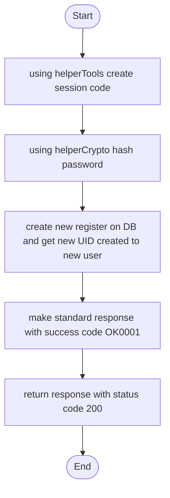
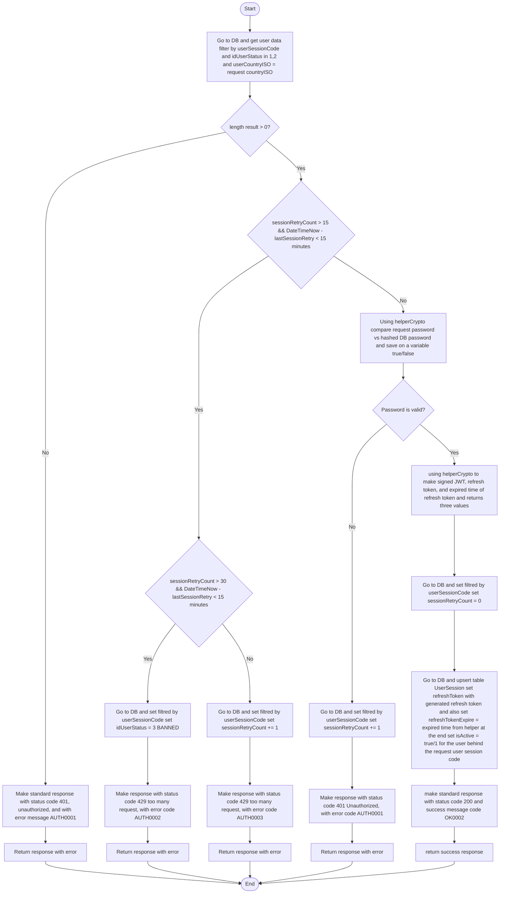
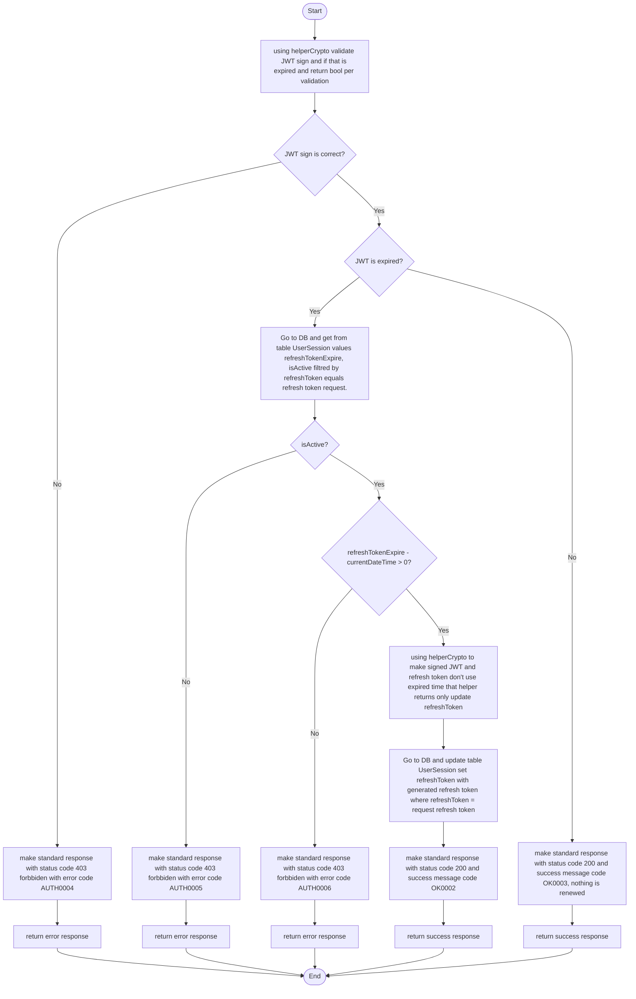
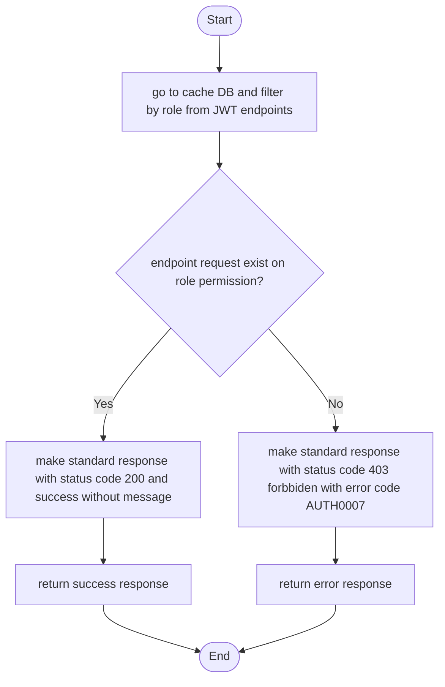

# AUTH FLOWS

---

## CREATE ACCOUNT FUNCTION

* CONTROLLER AUTHCONTROLLEER 

[> [!IMPORTANT]
> in that flow for create account you should create 2 endpoints one public that when try to create user should assign role with public code: RCPU and other endpoint private in where request should has role to asign when create user]

## SIGNING FUCNTION

* CONTROLLER AUTHCONTROLLEER

## VALIDATE SESSION FUNCTION

* FUNCTION TO BE AN DECORATOR FOR ENDPOINTS

## VALIDATE ROLE FUNCTION

* FUNCTION TO BE AN DECORATOR FOR ENDPOINTS

### FUNCTIONS FEATURES

* Adapt that flows with existing database if some column doesn't exist adapt flows to don't use it, you should use strictly current DB
* You should make DTOs by your criteria and known of tables
* Your criteria should validate request before using middleware to validate if password length is correct, email has correct format, etc. If some is wrong before entry flow should response with status 400 and as messageError for standard DTO, you should send error as unique string separated for | indicating what is wrong with request
* on create account you should create an session code A-Z a-z code and save it on DB
* for encrypt and validate password, use Argon 2 with salt if needs some secret key should live on appsettings.json
* for JWT you should use standard signed library for JWT on AOT .NET 10, secret key to sign JWT should be stay on env file, remember env should be injected using ISettings

### MESSAGE ERROR AND SUCCESS BY CODE

* OK0001: Cuenta creada con exito
* OK0002: Sesion iniciada con exito
* OK0003: Su sesion sigue siendo valida
* AUTH0001: El usuario o contrasenia no son correctos por favor valide nuevamente
* AUTH0002: Han sido demasiados intentos su usuario ha sido bloqueado por temas de prevencion sobre ataques de fuerza bruta
* AUTH0003: Ha reintentado muchas veces en un corto periodo de tiempo, su usuario ha sido bloqueado temporalmente por prevencion no siga intentando en los proximos 15 mins o sera bloqueado permanentemente
* AUTH0004: Token malformado por favor inicie sesion nuevamente para continuar
* AUTH0005: Sesion invalida por favor inicie sesion nuevamente
* AUTH0006: Su sesion ha expirado por favor inicie sesion nuevamente
* AUTH0007: Su usuario no cuenta con los permisos necesarios

[> [!IMPORTANT]
> now i don't see swagger functional, you should solve it and put swagger to when i put on browser localhost:3000/swagger i can see swagger
> you should addapt that flows to can be used on my API and create decorator to use validate session
> if Session is refresh you should add to data from standard response an new key called refreshSession and return new refreshToken and token signed to rotate session]
